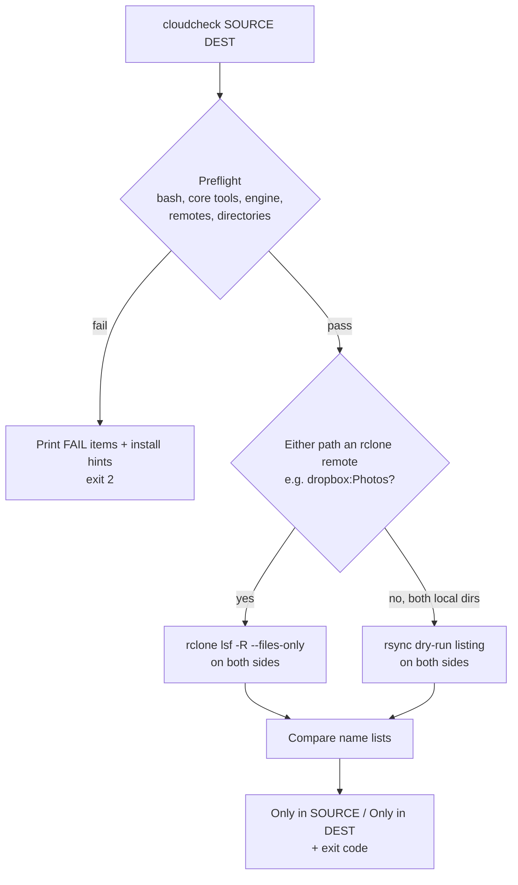

# cloudcheck

## Overview

`cloudcheck` is a bash CLI that checks whether two folders (e.g. Dropbox and Google Drive) contain the **same file names**, and prints every file that exists on only one side. It runs on **macOS and Linux**, checks its dependencies before every run, and uses rsync or rclone as required.

By default only names (relative paths) are compared. File contents are never read, so it only needs directory listings and is fast even on large folders. Content checks are available as opt-in flags.



- **rclone** is used whenever either path is an rclone remote (`name:path`). rsync cannot talk to the Dropbox or Drive APIs.
- **rsync** is used only when both paths are local folders, e.g. the desktop-client folders or an rclone/FUSE mount.
- Only files are compared. A folder that exists but is empty on one side is not reported.
- Google Drive allows two files with the same name in one folder; such duplicates count once.

## Requirements

| Dependency | Needed for | Notes |
| --- | --- | --- |
| bash >= 3.2 | always | macOS `/bin/bash` (3.2) is fine |
| awk, mktemp, mkdir, sort, cut, grep, sed, tr, cp, mv, rm, uname | always | Preinstalled on macOS and Linux |
| rclone >= 1.52 | remote paths | |
| rsync | local-only paths | Must support `--out-format` (plus `--itemize-changes`/`--delete` for content checks); Homebrew's rsync on macOS |
| jq | optional | Only used by `--checksum` to warn when two remotes share no hash type |

## Install

### macOS

```bash
brew install rclone rsync jq
# Make sure Homebrew's rsync wins over /usr/bin/rsync
echo 'export PATH="$(brew --prefix)/bin:$PATH"' >> ~/.zshrc && source ~/.zshrc
```

Install [Homebrew](https://brew.sh) first if you don't have it.

### Linux (Pop!_OS / Ubuntu / Debian)

```bash
sudo apt install rclone rsync jq
```

The distro `rclone` can lag behind; if preflight reports it as too old, use the [official installer](https://rclone.org/install/).

### Both

```bash
mkdir -p ~/.local/bin
install -m 755 tools/cloudcheck/cloudcheck ~/.local/bin/cloudcheck   # ensure ~/.local/bin is on PATH
rclone config            # create remotes, e.g. "dropbox" and "gdrive"
cloudcheck --preflight   # verify everything is ready
```

To edit the script: `nvim ~/.local/bin/cloudcheck`

## Usage

```bash
# Compare file names between Dropbox and Google Drive
cloudcheck dropbox:Photos gdrive:Photos

# Treat "Report.PDF" and "report.pdf" as the same; skip macOS junk files
cloudcheck -i -x .DS_Store -x '._*' dropbox:Docs gdrive:Docs

# Only list what is in Dropbox but missing from Drive
cloudcheck -1 dropbox:Docs gdrive:Docs

# Locally synced folders (uses rsync)
cloudcheck ~/Dropbox/Projects ~/GoogleDrive/Projects

# macOS desktop-client folders (File Provider locations)
cloudcheck ~/Library/CloudStorage/Dropbox/Projects \
  "$HOME/Library/CloudStorage/GoogleDrive-you@example.com/My Drive/Projects"
```

### Example output

```text
Comparing names (rclone): dropbox:Photos  ->  gdrive:Photos

Only in dropbox:Photos (2):
  2024/IMG_0012.jpg
  2024/IMG_0013.jpg

Only in gdrive:Photos (1):
  Untitled.gdoc

on-both-sides: 1480  only-in-source: 2  only-in-dest: 1  errors: 0
RESULT: MISMATCH
```

### Options

| Option | Description |
| --- | --- |
| `-i, --ignore-case` | Treat names that differ only in letter case as the same |
| `-1, --one-way` | Only report files in SOURCE missing from DEST |
| `-x, --exclude PATTERN` | Exclude pattern (repeatable) |
| `-r, --report FILE` | Write the full per-file result list (with markers) to FILE |
| `-e, --engine ENGINE` | `auto` (default), `rsync`, `rclone` |
| `-p, --preflight` | Check dependencies (and paths, if given), then exit |
| `-q, --quiet` | Summary only |
| `-v, --verbose` | Show passing preflight checks, files on both sides and the underlying commands |
| `-h, --help` / `-V, --version` | Help / version |

Options may appear before or after the paths.

### Optional content checks

Off by default. Each also reports files present on both sides whose content differs.

| Option | Description |
| --- | --- |
| `-s, --size-only` | Compare sizes |
| `-c, --checksum` | Compare hashes. Dropbox and Drive share no hash type, so for that pair rclone falls back to size (a warning is printed) |
| `-d, --download` | rclone only: download both sides and compare bytes |

### Report file and exit codes

`--report` writes one line per file:

```text
+ path    only in SOURCE
- path    only in DEST
= path    on both sides
* path    content differs (content checks only)
! path    read error
```

| Exit code | Meaning |
| --- | --- |
| `0` | Same file names on both sides |
| `1` | Differences found |
| `2` | Usage error, failed preflight, or listing error |

Exit codes make it suitable for cron, launchd (macOS) or systemd timers.

## Preflight

Every run checks only what that run needs (bash, core tools, the chosen engine, that each `remote:` is configured, that local paths exist) and stops with exit code `2` and an install hint for each failure. Pass `-v` to see the passing checks too.

`--preflight` checks everything and exits. Add paths to also validate them:

```bash
cloudcheck --preflight
cloudcheck --preflight dropbox:Photos gdrive:Photos
```

```text
Preflight (Darwin):
  [ok]   bash 3.2.57(1)-release
  [ok]   core tools (awk mktemp sort cut grep sed)
  [ok]   rclone v1.68.1
  [FAIL] openrsync: protocol version 29 does not support the required options ... -> brew install rsync
  [ok]   jq jq-1.7.1
  [ok]   rclone remote 'dropbox:' is configured
  [FAIL] rclone remote 'gdrive:' not found -> run: rclone config  (configured: dropbox:)
cloudcheck: preflight failed; fix the items marked FAIL above.
```

The rsync check is a functional probe: it runs a tiny dry-run with the exact options the run needs, rather than trusting the version string.

## Caveats

- **Google Docs/Sheets/Slides** have no real file in Drive. rclone lists them with an export extension (e.g. `.docx`) by default, so they usually show up as "only in" Drive. To skip them, add `skip_gdocs = true` to the Drive remote in `rclone.conf`, or run with `RCLONE_DRIVE_SKIP_GDOCS=true cloudcheck ...`.
- **Case:** Dropbox is case-insensitive, Drive is case-sensitive. Use `-i` if renames that only changed case should not count.
- **Unicode:** names with accented characters can be stored in different Unicode forms (e.g. NFD on macOS). If such names show up on both sides of the output, that is the cause.
- **Characters rclone encodes:** some characters invalid on one backend are stored with substitutes by rclone; names created outside rclone are listed as the provider stores them.

## Portability notes

- Written for bash 3.2: no associative arrays, empty-array expansions are guarded for `set -u`, and no `mapfile`.
- Uses only POSIX/BSD-compatible tool flags (no `sed -i`, no GNU-only options).
- Tested on Linux (bash 5.2, rsync 3.2.7, rclone 1.60). macOS behaviour was checked by simulating `uname` and an openrsync-style rsync, not on real macOS hardware.
