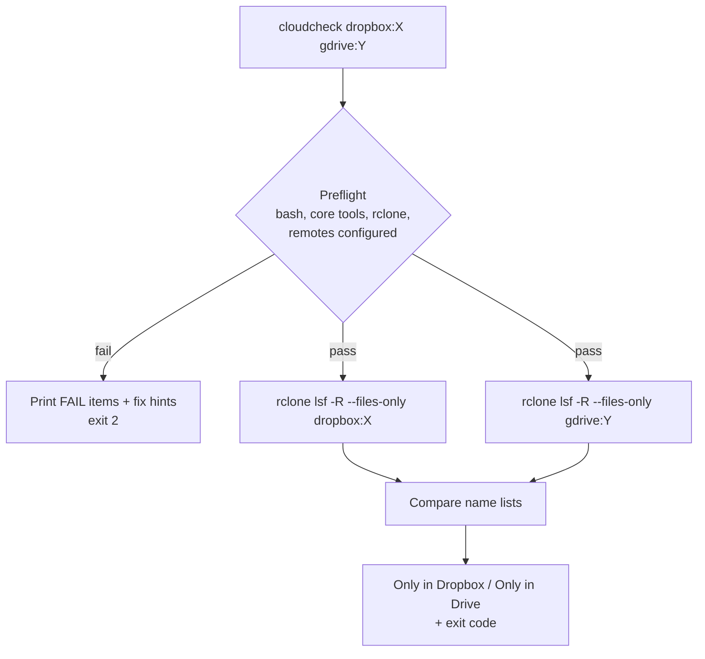

# cloudcheck

## Overview

`cloudcheck` is a bash CLI that uses [rclone](https://rclone.org) to check whether a Dropbox folder and a Google Drive folder contain the **same file names**, and prints every file that exists on only one side. It talks to both services directly over their APIs, so nothing needs to be synced locally. It runs on **macOS and Linux** and checks its dependencies before every run.

Only names (paths relative to the folders being compared) are compared by default. File contents are never read or downloaded; only folder listings are fetched. Content checks are available as opt-in flags.



## Requirements

| Dependency | Needed for | Notes |
| --- | --- | --- |
| rclone >= 1.52 | always | One remote configured per account |
| bash >= 3.2 | always | macOS `/bin/bash` (3.2) is fine |
| awk, mktemp, mkdir, sort, cut, grep, sed, tr, cp, mv, rm, uname | always | Preinstalled on macOS and Linux |
| jq | optional | Only used by `--checksum` |

## Setup

### 1. Install rclone

```bash
# macOS (install Homebrew from https://brew.sh first if needed)
brew install rclone

# Pop!_OS / Ubuntu / Debian
sudo apt install rclone
```

The distro `rclone` can lag behind; if preflight reports it as too old, use the [official installer](https://rclone.org/install/).

### 2. Connect Dropbox and Google Drive

`rclone config` is interactive and opens a browser for each login. Credentials are stored in `~/.config/rclone/rclone.conf`.

```bash
rclone config
# n -> name: dropbox -> storage: dropbox -> accept defaults -> log in via browser
# n -> name: gdrive  -> storage: drive   -> scope: drive.readonly -> accept defaults -> log in via browser
rclone listremotes        # should print: dropbox:  gdrive:
rclone lsd dropbox:       # sanity check: top-level folders
rclone lsd gdrive:
```

- **Read-only access:** choose the `drive.readonly` scope for Drive. `cloudcheck` never writes.
- **Machine without a browser:** run `rclone authorize "dropbox"` (or `"drive"`) on a machine that has one and paste the result into `rclone config`.
- **Large Drive folders:** create your own Google API client ID and enter it during `rclone config` to avoid hitting Google's shared rate limits. See [Making your own client_id](https://rclone.org/drive/#making-your-own-client-id).
- **Expired login:** `rclone config reconnect dropbox:` (or `gdrive:`).

You can use any remote names; the examples assume `dropbox` and `gdrive`.

### 3. Install cloudcheck

Download the script straight into `~/.local/bin` (works from any directory):

```bash
mkdir -p ~/.local/bin
curl -fsSL -o ~/.local/bin/cloudcheck \
  https://raw.githubusercontent.com/cchowgule/cchowgule.github.io/ccr-90e4e661-neaimk/tools/cloudcheck/cloudcheck
chmod 755 ~/.local/bin/cloudcheck
```

Or, from a clone of the repo (the path is relative to the repo root):

```bash
git clone -b ccr-90e4e661-neaimk https://github.com/cchowgule/cchowgule.github.io.git
cd cchowgule.github.io
mkdir -p ~/.local/bin
install -m 755 tools/cloudcheck/cloudcheck ~/.local/bin/cloudcheck
```

Once this branch is merged, replace `ccr-90e4e661-neaimk` with `main` in both.

Make sure `~/.local/bin` is on your `PATH`. Pop!_OS adds it automatically at login if the directory exists (log out and back in once). On macOS add it yourself:

```bash
echo 'export PATH="$HOME/.local/bin:$PATH"' >> ~/.zshrc && source ~/.zshrc
```

Then verify:

```bash
command -v cloudcheck     # should print ~/.local/bin/cloudcheck
cloudcheck --preflight dropbox:Photos gdrive:Photos
```

To edit the script: `nvim ~/.local/bin/cloudcheck`

## Usage

```bash
# Compare file names between Dropbox and Google Drive
cloudcheck dropbox:Photos gdrive:Photos

# Treat "Report.PDF" and "report.pdf" as the same; skip macOS junk files
cloudcheck -i -x .DS_Store -x '._*' dropbox:Docs gdrive:Docs

# Only list what is in Dropbox but missing from Drive
cloudcheck -1 dropbox:Docs gdrive:Docs

# Ignore Google Docs/Sheets/Slides (they have no Dropbox counterpart)
RCLONE_DRIVE_SKIP_GDOCS=true cloudcheck dropbox:Docs gdrive:Docs
```

Folders with spaces need quoting: `cloudcheck "dropbox:My Files" "gdrive:My Files"`.

### Example output

```text
Comparing names: dropbox:Photos  ->  gdrive:Photos

Only in dropbox:Photos (2):
  2024/IMG_0012.jpg
  2024/IMG_0013.jpg

Only in gdrive:Photos (1):
  Untitled.docx

on-both-sides: 1480  only-in-source: 2  only-in-dest: 1  errors: 0
RESULT: MISMATCH
```

### Options

| Option | Description |
| --- | --- |
| `-i, --ignore-case` | Treat names that differ only in letter case as the same |
| `-1, --one-way` | Only report files in SOURCE missing from DEST |
| `-x, --exclude PATTERN` | Exclude pattern, [rclone filter syntax](https://rclone.org/filtering/) (repeatable) |
| `-r, --report FILE` | Write the full per-file result list (with markers) to FILE |
| `-p, --preflight` | Check dependencies (and remotes, if paths given), then exit |
| `-q, --quiet` | Summary only |
| `-v, --verbose` | Show passing preflight checks, files on both sides and the rclone commands |
| `-h, --help` / `-V, --version` | Help / version |

Options may appear before or after the paths.

### Optional content checks

Off by default. Each also reports files present on both sides whose content differs.

| Option | Description |
| --- | --- |
| `-s, --size-only` | Compare sizes |
| `-c, --checksum` | Compare hashes. Dropbox and Drive share no hash type, so for that pair rclone falls back to size (a warning is printed) |
| `-d, --download` | Download both sides and compare bytes (slow, uses bandwidth) |

### Report file and exit codes

`--report` writes one line per file:

```text
+ path    only in SOURCE
- path    only in DEST
= path    on both sides
* path    content differs (content checks only)
! path    read error
```

| Exit code | Meaning |
| --- | --- |
| `0` | Same file names on both sides |
| `1` | Differences found |
| `2` | Usage error, failed preflight, or listing error (e.g. folder not found) |

Exit codes make it suitable for cron, launchd (macOS) or systemd timers.

## Preflight

Every run first checks bash, the core tools, rclone and its version, and that each `remote:` in the arguments is configured. It stops with exit code `2` and a fix hint for each failure. Pass `-v` to see the passing checks too.

```text
Preflight (Darwin):
  [ok]   bash 3.2.57(1)-release
  [ok]   core tools (awk mktemp sort cut grep sed)
  [ok]   rclone v1.68.1
  [ok]   jq jq-1.7.1
  [ok]   rclone remote 'dropbox:' is configured
  [FAIL] rclone remote 'gdrive:' not found -> run: rclone config  (configured: dropbox:)
cloudcheck: preflight failed; fix the items marked FAIL above.
```

## Caveats

- **Google Docs/Sheets/Slides** have no real file in Drive. rclone lists them with an export extension (e.g. `.docx`), so they usually show up as "only in" Drive. Skip them with `RCLONE_DRIVE_SKIP_GDOCS=true` or by adding `skip_gdocs = true` to the `gdrive` remote in `rclone.conf`.
- **Case:** Dropbox is case-insensitive, Drive is case-sensitive. Use `-i` if renames that only changed case should not count.
- **Duplicate names:** Drive allows two files with the same name in one folder; they count once.
- **Empty folders** are not compared; only files are.
- **Unicode:** names with accented characters can be stored in different Unicode forms. If the same-looking name appears in both "Only in" lists, that is the cause.
- **Characters rclone encodes:** characters invalid on one backend are shown with substitutes by rclone, which can make a name differ between the two sides.

## Portability notes

- Written for bash 3.2: no associative arrays, empty-array expansions are guarded for `set -u`, and no `mapfile`.
- Uses only POSIX/BSD-compatible tool flags (no `sed -i`, no GNU-only options).
- Tested on Linux (bash 5.2, rclone 1.60) using rclone alias remotes in place of real Dropbox/Drive accounts. Not yet run on real macOS hardware or against live Dropbox/Drive accounts.
