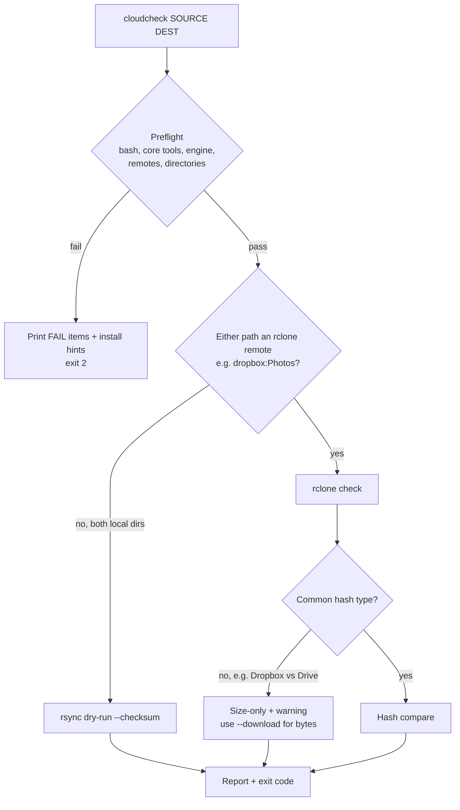

# cloudcheck

## Overview

`cloudcheck` is a bash CLI that checks whether the files in one folder (e.g. Dropbox) match those in another (e.g. Google Drive). It runs on **macOS and Linux**, checks its dependencies before every run, and picks the comparison engine automatically.



- **rclone** is used whenever either path is an rclone remote (`name:path`). rsync cannot talk to the Dropbox or Drive APIs.
- **rsync** is used only when both paths are local folders, e.g. the desktop-client folders or an rclone/FUSE mount.
- **Hash caveat:** Dropbox only exposes its own `dropbox` hash; Drive exposes MD5/SHA1/SHA256. With no hash in common, `rclone check` falls back to comparing sizes only. `cloudcheck` warns when this happens; use `--download` for a true byte comparison (downloads both sides).

## Requirements

| Dependency | Needed for | Notes |
| --- | --- | --- |
| bash >= 3.2 | always | macOS `/bin/bash` (3.2) is fine |
| mktemp, mkdir, sort, comm, cut, grep, sed, tr, cp, mv, rm, uname | always | Preinstalled on macOS and Linux |
| rclone >= 1.52 | remote paths | Needs `check --combined` |
| rsync with `--itemize-changes`/`--out-format` | local-only paths | macOS's bundled rsync (openrsync / 2.6.9) may fail the probe; install Homebrew's |
| jq | optional | Enables the hash-compatibility warning |

## Install

### macOS

```bash
brew install rclone rsync jq
# Make sure Homebrew's rsync wins over /usr/bin/rsync
echo 'export PATH="$(brew --prefix)/bin:$PATH"' >> ~/.zshrc && source ~/.zshrc
```

Install [Homebrew](https://brew.sh) first if you don't have it.

### Linux (Pop!_OS / Ubuntu / Debian)

```bash
sudo apt install rclone rsync jq
```

The distro `rclone` can lag behind; if preflight reports it as too old, use the [official installer](https://rclone.org/install/).

### Both

```bash
mkdir -p ~/.local/bin
install -m 755 tools/cloudcheck/cloudcheck ~/.local/bin/cloudcheck   # ensure ~/.local/bin is on PATH
rclone config            # create remotes, e.g. "dropbox" and "gdrive"
cloudcheck --preflight   # verify everything is ready
```

To edit the script: `nvim ~/.local/bin/cloudcheck`

## Preflight

Every run checks only what that run needs (bash, core tools, the chosen engine, that each `remote:` is configured, that local paths exist) and stops with exit code `2` and an install hint for each failure. Pass `-v` to see the passing checks too.

`--preflight` checks everything and exits. Add paths to also validate them:

```bash
cloudcheck --preflight
cloudcheck --preflight dropbox:Photos gdrive:Photos
```

```text
Preflight (Darwin):
  [ok]   bash 3.2.57(1)-release
  [ok]   core tools (mktemp sort comm cut grep sed)
  [ok]   rclone v1.68.1
  [FAIL] openrsync: protocol version 29 does not support the required options ... -> brew install rsync
  [ok]   jq jq-1.7.1
  [ok]   rclone remote 'dropbox:' is configured
  [FAIL] rclone remote 'gdrive:' not found -> run: rclone config  (configured: dropbox:)
cloudcheck: preflight failed; fix the items marked FAIL above.
```

The rsync check is a functional probe: it runs a tiny dry-run with the exact options `cloudcheck` uses rather than trusting the version string.

## Usage

```bash
# Both remotes, byte-level comparison
cloudcheck dropbox:Photos gdrive:Photos --download

# Fast, size-only
cloudcheck -s dropbox:Photos gdrive:Photos

# Locally synced folders (uses rsync)
cloudcheck ~/Dropbox/Projects ~/GoogleDrive/Projects

# macOS desktop-client folders (File Provider locations)
cloudcheck ~/Library/CloudStorage/Dropbox/Projects \
  "$HOME/Library/CloudStorage/GoogleDrive-you@example.com/My Drive/Projects"

# Only check that everything in Dropbox exists in Drive; skip temp files; save the full list
cloudcheck -1 -x '*.tmp' -r diff.txt dropbox:Docs gdrive:Docs
```

On macOS, online-only files in `~/Library/CloudStorage` are downloaded when rsync reads them for checksums. Use `-s` for a quick pass, or compare via rclone remotes instead.

| Option | Description |
| --- | --- |
| `-e, --engine ENGINE` | `auto` (default), `rsync`, `rclone` |
| `-s, --size-only` | Compare sizes only |
| `-d, --download` | rclone: download and compare bytes |
| `-1, --one-way` | Ignore files that exist only in DEST |
| `-x, --exclude PATTERN` | Exclude pattern (repeatable) |
| `-r, --report FILE` | Write full per-file results, including identical files |
| `-p, --preflight` | Check dependencies (and paths, if given), then exit |
| `-q, --quiet` | Summary only |
| `-v, --verbose` | Show passing preflight checks, identical files and the underlying command |
| `-h, --help` / `-V, --version` | Help / version |

Options may appear before or after the paths.

## Output

```text
+ onlya          only in SOURCE
- onlyb          only in DEST
* sub/diff       content differs
= same           identical (verbose / report only)
! path           read error
identical: 2  differ: 2  only-in-source: 1  only-in-dest: 1  errors: 0
RESULT: MISMATCH
```

| Exit code | Meaning |
| --- | --- |
| `0` | Folders match |
| `1` | Differences found |
| `2` | Usage error, failed preflight, or engine error |

Exit codes make it suitable for cron, launchd (macOS) or systemd timers.

## Portability notes

- Written for bash 3.2: no associative arrays, empty-array expansions are guarded for `set -u`, and no `mapfile`.
- Uses only POSIX/BSD-compatible tool flags (no `sed -i`, no GNU-only options).
- Tested on Linux (bash 5.2, rsync 3.2.7, rclone 1.60). macOS behaviour was checked by simulating `uname` and an openrsync-style rsync, not on real macOS hardware.
