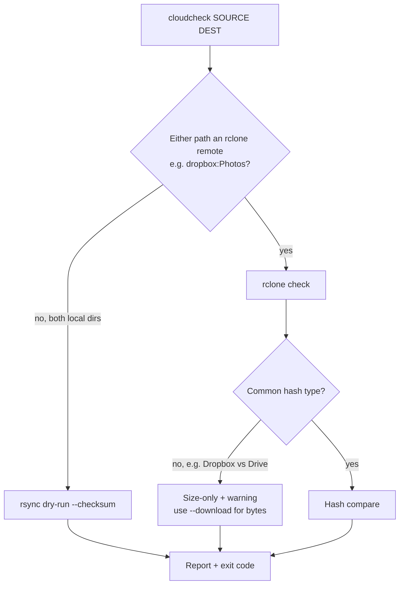

# cloudcheck

## Overview

Bash CLI that checks whether files in one folder (e.g. Dropbox) match those in another (e.g. Google Drive). It picks the engine automatically:



- rsync cannot talk to Dropbox or Drive APIs, so it is used only when both folders are local (Dropbox desktop client folder, rclone/ocamlfuse mount, etc.).
- Dropbox only exposes its own `dropbox` hash; Drive exposes MD5/SHA1/SHA256. With no common hash, `rclone check` silently falls back to size-only. `cloudcheck` warns about this; pass `--download` for a true byte comparison (downloads both sides).

## Install

```bash
sudo apt install rclone rsync jq    # jq is optional; enables the hash-compatibility warning
rclone config                       # create remotes, e.g. "dropbox" and "gdrive"
install -m 755 cloudcheck ~/.local/bin/cloudcheck
```

To edit: `nvim ~/.local/bin/cloudcheck`

## Usage

```bash
# Both remotes, byte-level comparison
cloudcheck dropbox:Photos gdrive:Photos --download

# Fast, size-only
cloudcheck -s dropbox:Photos gdrive:Photos

# Locally synced folders (uses rsync)
cloudcheck ~/Dropbox/Projects ~/GoogleDrive/Projects

# Only care that everything in Dropbox exists in Drive; skip temp files; save full list
cloudcheck -1 -x '*.tmp' -r diff.txt dropbox:Docs gdrive:Docs
```

| Option | Description |
| --- | --- |
| `-e, --engine` | `auto` (default), `rsync`, `rclone` |
| `-s, --size-only` | Compare sizes only |
| `-d, --download` | rclone: download and compare bytes |
| `-1, --one-way` | Ignore files that exist only in DEST |
| `-x, --exclude PATTERN` | Exclude pattern (repeatable) |
| `-r, --report FILE` | Write full per-file results, including identical files |
| `-q, --quiet` | Summary only |
| `-v, --verbose` | List identical files and show the underlying command |

## Output

```text
+ onlya          only in SOURCE
- onlyb          only in DEST
* sub/diff       content differs
= same           identical (verbose / report only)
! path           read error
identical: 2  differ: 2  only-in-source: 1  only-in-dest: 1  errors: 0
RESULT: MISMATCH
```

Exit codes: `0` match, `1` mismatch, `2` usage or runtime error. Suitable for cron/systemd timers.
